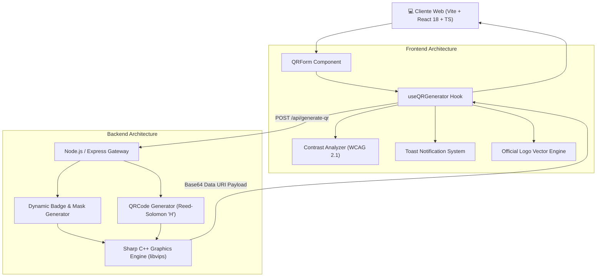

<div align="center">

# 🌐 Generador QR Empresarial Pro
### *Enterprise-Grade Dynamic QR Code Generation System*

[](https://react.dev/)
[](https://www.typescriptlang.org/)
[](https://vitejs.dev/)
[](https://nodejs.org/)
[](https://expressjs.com/)
[](https://sharp.pixelplumbing.com/)
[](https://tailwindcss.com/)
[](LICENSE)

<p align="center">
  <b>Una plataforma full-stack moderna y resiliente para la generación, personalización visual y procesamiento de códigos QR de alta fidelidad con incrustación de logotipos corporativos, análisis de contraste en tiempo real y tolerancia a fallos de nivel industrial.</b>
</p>

[Demostración](#-características-principales) •
[Arquitectura](#-arquitectura-del-sistema) •
[Pila Tecnológica](#-tecnologías-y-dependencias) •
[Guía de Instalación](#-instalación-y-despliegue) •
[Especificación de la API](#-especificación-de-la-api-rest) •
[Autor](#-autor-y-contacto)

---

</div>

## 📌 Resumen Ejecutivo

Este proyecto fue diseñado bajo estándares de ingeniería de software de alto rendimiento, resolviendo las deficiencias comunes de los generadores QR convencionales (baja resolución, degradación en escaneo al incrustar imágenes, nula accesibilidad fotométrica y falta de soporte vectorial).

La solución implementa una **arquitectura desacoplada en dos capas (Frontend SPA + API REST Microservice)**, con procesamiento gráfico en memoria a través de tuberías C++ compiladas (libvips / Sharp), garantizando tiempos de respuesta sub-100ms sin tocar disco y asegurando la integridad criptográfica y estructural de cada matriz QR.

---

## ⚡ Características Principales

### 🏢 1. Molde Central y Composición Vectorial de Marca
* **Logotipos Corporativos de Alta Precisión:** Biblioteca integrada con vectores oficiales de marcas líderes (**Google, Apple, Mercado Pago, PayPal, WhatsApp, Telegram, Instagram, TikTok, YouTube, Facebook, LinkedIn, X, Spotify, Discord, GitHub**) y servicios esenciales.
* **Geometría de Molde Protector (Squircle / Curvatura Continua):** Algoritmo de curvatura continua al 24% para evitar cortes toscos de 90°. El badge central aísla el logo con antialiasing subpíxel para prevenir la interferencia con los módulos sincronizadores del QR.
* **Formatos de Molde Disponibles:** 
  * `squircle`: Burbuja suave con bordes redondeados y fondo protector blanco.
  * `circle`: Badge circular simétrico para logotipos redondos.
  * `none`: Superposición flotante directa sobre la matriz.
* **Escala Dinámica Parametrizable:** Ajuste seguro en 18% (Pequeño), 22% (Mediano) y 26% (Grande).

### 🛡️ 2. Tolerancia a Fallos Industrial (Reed-Solomon Nivel H)
* Generación bajo la especificación **ISO/IEC 18004 con Nivel de Corrección H (30%)**.
* Garantiza que hasta el **30% de la superficie del código puede ser ocluida o dañada** (por el logotipo central, rasgaduras físicas o suciedad) sin comprometer la capacidad de decodificación de ningún lector móvil.

### 🎨 3. Evaluador de Contraste Fotométrico en Tiempo Real (WCAG 2.1)
* Algoritmo de cálculo de **Luminancia Relativa** y ratio de contraste estandarizado según **WCAG 2.1 / ISO 9241-391**:
  $$\text{Contrast Ratio} = \frac{L_1 + 0.05}{L_2 + 0.05}$$
* Clasificación instantánea en tres estados:
  * 🟢 **Excelente / Óptimo** ($\ge 7:1$)
  * 🟡 **Aceptable** ($4.5:1$ a $7:1$)
  * 🔴 **Bajo Contraste** ($< 4.5:1$) con alertas no bloqueantes para prevenir códigos ilegibles bajo luz solar directa.
* Selector con **8 paletas cromáticas rápidas de alta absorción**.

### 📱 4. Soporte Multi-Carga Estructurada (7 Tipos de QR)
1. **URL:** Redirección web estándar con protocolo normalizado.
2. **WhatsApp:** Enlace universal directo `api.whatsapp.com/send` con codificación URI de mensaje predefinido.
3. **WiFi:** Formato de red `WIFI:T:<auth>;S:<ssid>;P:<password>;H:<hidden>;;` con soporte para WPA/WPA2/WEP y redes ocultas.
4. **vCard 3.0:** Tarjeta de contacto ejecutiva (RFC 2426) con nombre, empresa, cargo, teléfono, correo y sitio web.
5. **Email:** Protocolo RFC 2368 `mailto:` con destinatario, asunto y cuerpo estructurado.
6. **Ubicación:** Coordenadas latitud/longitud o consulta geográfica para Google Maps / GPS.
7. **Texto Plano:** Carga de texto libre UTF-8 para notas o identificadores.

### 🚀 5. Dual-Pipeline de Renderizado y Portapapeles
* **Exportación Vectorial Pura:** Generación de archivos `.SVG` escalables infinitamente sin pixelación para cartelería e imprenta.
* **Exportación Rasterizada Optimizada:** Formatos `.PNG` transparente, `.JPG` (calidad 92 con compresión Huffman) y `.PDF`.
* **Copiado al Portapapeles en 1 Clic:** Copiado nativo asíncrono con `navigator.clipboard.write()` de la imagen binaria para pegar directo en WhatsApp Web, Slack, Photoshop o correo.

---

## 🏛️ Arquitectura del Sistema



---

## 🛠️ Tecnologías y Dependencias

### Frontend
| Componente | Versión | Justificación Técnica |
| :--- | :--- | :--- |
| **React** | `18.3.1` | Renderizado declarativo con soporte para Concurrent Mode y Hooks optimizados. |
| **TypeScript** | `5.5.3` | Tipado estático estricto, interfaces compartidas y prevención de regresiones. |
| **Vite** | `5.4.8` | Bundler ESM de última generación con Hot Module Replacement (HMR) instantáneo. |
| **Tailwind CSS** | `3.4.1` | Utility-first CSS con soporte completo para modo oscuro y diseño responsive adaptativo. |
| **Lucide React** | `0.344.0` | Iconografía SVG ligera, coherente y accesible. |
| **i18next** | `23.10.0` | Arquitectura de internacionalización para Español, Inglés y Portugués. |

### Backend
| Componente | Versión | Justificación Técnica |
| :--- | :--- | :--- |
| **Node.js** | `>=18.0.0` | Runtime de alto throughput asíncrono basado en el motor V8. |
| **Express** | `4.18.2` | Servidor HTTP minimalista y modular con middleware CORS configurable. |
| **Sharp** | `0.34.5` | Motor de procesamiento de imágenes compilado en C++ (libvips). Multi-hilo y sin bloqueo del Event Loop. |
| **qrcode** | `1.5.3` | Generador de matrices QR con control matemático de redundancia y dimensiones. |

---

## 📂 Estructura del Repositorio

```text
generador-qr-empresarial/
├── .gitignore                      # Reglas de exclusión globales (node_modules, dist, .env)
├── LICENSE                         # Licencia de código abierto MIT
├── README.md                       # Documentación técnica raíz del proyecto
├── Backend/
│   ├── api/
│   │   └── index.js                # Controlador Express, compositor Sharp y rutas
│   ├── package.json                # Dependencias del servidor
│   ├── vercel.json                 # Configuración de despliegue serverless
│   └── README.md                   # Documentación específica del backend
└── Frontend/
    ├── src/
    │   ├── components/
    │   │   ├── common/             # ToastContainer, Modales y feedback visual
    │   │   ├── history/            # Registro cronológico local de descargas
    │   │   ├── layout/             # Header, Hero y Footer institucional
    │   │   └── qr/                 # QRForm (Controles avanzados) y QRDisplay (Preview & Copy)
    │   ├── context/                # ToastContext y proveedores de estado global
    │   ├── hooks/                  # useQRGenerator, useDarkMode, useLanguage
    │   ├── services/               # Clientes HTTP API (fetch con tipado)
    │   ├── types/                  # Modelos de dominio e interfaces TypeScript
    │   └── utils/                  # Algoritmos: contrastUtils, logoPresets, qrUtils, fileUtils
    ├── package.json                # Dependencias del cliente
    └── vite.config.ts              # Configuración de compilación Vite
```

---

## 🚀 Instalación y Despliegue

### Requisitos Previos
* **Node.js** `>= 18.0.0`
* Gestor de paquetes: **pnpm** (recomendado) o **npm**

### 1. Clonar el Repositorio
```bash
git clone https://github.com/ByChokeYT/generador-qr-empresarial-.git
cd generador-qr-empresarial-
```

### 2. Configurar y Ejecutar el Backend
```bash
cd Backend
npm install
npm start
```
> El servicio se iniciará por defecto en `http://localhost:3800`.

### 3. Configurar y Ejecutar el Frontend
En otra terminal:
```bash
cd Frontend
npm install --legacy-peer-deps
npm run dev
```
> La aplicación estará disponible en `http://localhost:5173`.

---

## 📡 Especificación de la API REST

### `POST /api/generate-qr`

Genera y compone una matriz QR personalizada con soporte de logotipo en memoria.

#### Encabezados de Petición
```http
Content-Type: application/json
```

#### Cuerpo de la Petición (Payload)
```json
{
  "url": "https://google.com",
  "size": 500,
  "format": "jpg",
  "color": "#000000",
  "logo": "data:image/png;base64,...",
  "logoShape": "squircle",
  "logoSize": "medium"
}
```

#### Esquema de Parámetros
| Campo | Tipo | Requerido | Valores Permitidos | Descripción |
| :--- | :--- | :--- | :--- | :--- |
| `url` | `string` | **Sí** | Texto o URI válida | Contenido decodificable del código QR. |
| `size` | `number` | No | `148` a `2000` (Default: `148`) | Dimensión de salida en píxeles (ancho y alto). |
| `format` | `string` | No | `"png"`, `"jpg"`, `"jpeg"`, `"pdf"`, `"svg"` | Formato mime de codificación. |
| `color` | `string` | No | Hexadecimal (`#000000`) | Color primario de los módulos oscuros. |
| `logo` | `string` | No | Data URI Base64 (`image/png`, etc.) | Imagen del logotipo central a incrustar. |
| `logoShape`| `string` | No | `"squircle"`, `"circle"`, `"none"` | Geometría del molde protector central. |
| `logoSize` | `string` | No | `"small"`, `"medium"`, `"large"` | Ratio de escala del logotipo respecto a la matriz. |

#### Respuesta Exitosa (`200 OK`)
```json
{
  "qrCode": "data:image/jpeg;base64,/9j/4AAQSkZJRgABAQ...",
  "size": 500
}
```

---

## 🔒 Auditoría de Seguridad y Rendimiento

1. **Zero-Disk Leak:** Ninguna imagen ni código generado toca el sistema de archivos del servidor. Todo el procesamiento corre en memoria mediante streams y `Buffer` binarios, previniendo condiciones de carrera y ataques de agotamiento de espacio en disco.
2. **CORS Whitelisting:** Configuración de cabeceras seguras restringiendo dominios según entornos de producción.
3. **Payload Sanitization:** Límite estricto de cuerpo en `express.json({ limit: '10mb' })` para evitar ataques de denegación de servicio (DoS) por saturación de memoria.
4. **Resistencia de Renderizado:** El Frontend cuenta con fallbacks automáticos para decodificación de URLs de datos SVG a canvas PNG si el cliente no soporta conversión directa.

---

## 👨‍💻 Autor y Contacto

Diseñado y desarrollado con los más altos estándares de ingeniería por:

<div align="center">

### **José Luis Choquevillca** (*bychoke*)
*Full-Stack Software Engineer & Solutions Architect*

[](https://bychokeportafolio.netlify.app/)
[](https://github.com/ByChokeYT)
[](https://www.linkedin.com/in/jose-luis-choquevillca)

</div>

---

## 📄 Licencia

Este proyecto está bajo la Licencia **MIT**. Consulta el archivo [LICENSE](LICENSE) para más información.
